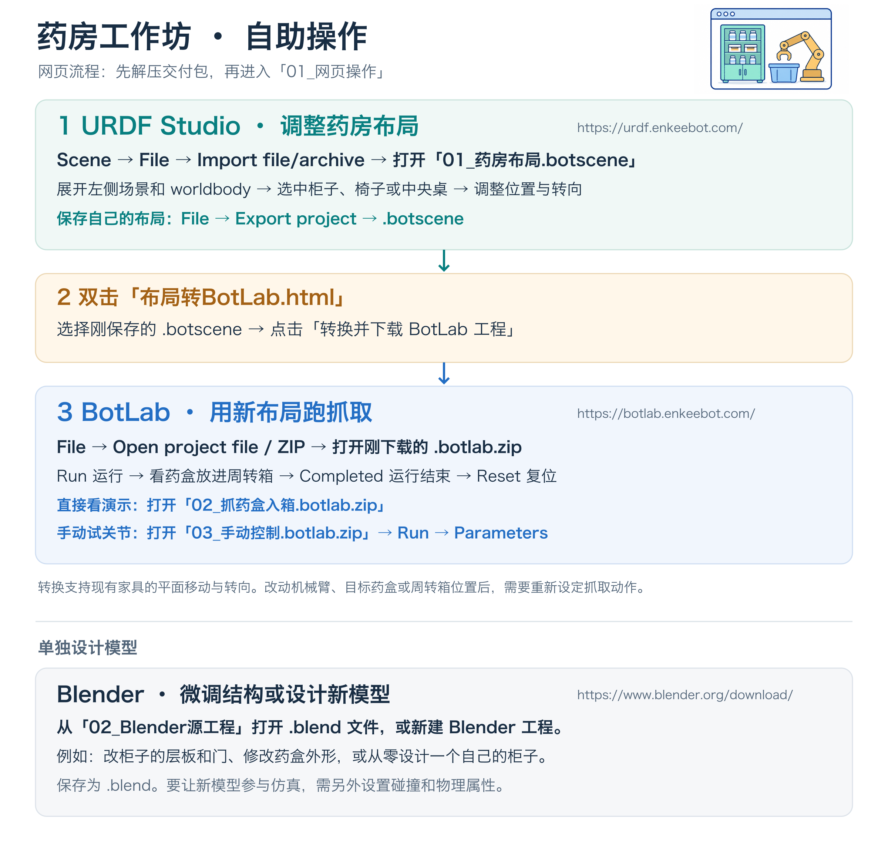

# 药房机器人工作坊

使用 URDF Studio 调整药房家具的位置，在 BotLab 观察机械臂和 Handle-L1 灵巧手把药盒放进周转箱。Blender 用于修改模型结构和自由建模。

**[下载完整资产包（ZIP）](https://github.com/xanthiawang/pharmacy-robotics-workshop/archive/0804612e1415b8c72e8e7d2536c6270b3262930e.zip)** · [操作说明](docs/使用说明.md) · [版本页面](https://github.com/xanthiawang/pharmacy-robotics-workshop/releases/tag/v2026.11.18)

下载后解压外层 ZIP。内部的 `.botscene` 和 `.botlab.zip` 直接用对应工具打开。

1. **摆放家具**：在 [URDF Studio](https://urdf.enkeebot.com/) 切到 **Scene**，打开 `01_药房布局.botscene`，修改柜子、椅子或中央桌的位置与转向，再用 **File → Export project** 保存。
2. **转换布局**：打开包内 `01_网页操作/布局转BotLab.html`，选择刚保存的 `.botscene`，点击 **转换并下载 BotLab 工程**。文件在本机浏览器内处理。
3. **运行抓取**：在 [BotLab](https://botlab.enkeebot.com/) 点 **File → Open project file / ZIP**，打开生成的 ZIP 并运行。只想先看抓取，可以直接打开包内的演示工程。

在 **02_Blender源工程** 中可以打开完整药房或空房间的两份 `.blend`。用 [Blender](https://www.blender.org/download/) 微调柜门、层板、药盒外形，也可以新建自己的模型。

`src/studio_layout_converter.html` 是转换器的开发模板。请从资产包打开已打包的转换页，里面包含 ZIP 处理库、药房模板和运行所需文件。

厂商模型随私有版本供获授权的项目成员使用。关于来源见资产包中的 `02_Blender源工程/licenses/资产来源.md`。
